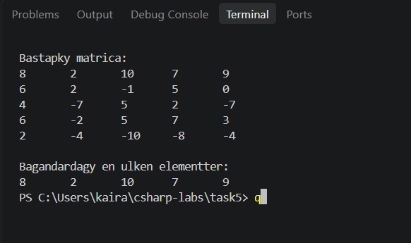

<<<<<<< Updated upstream

# 5-тапсырма: Екі өлшемді массивтер (3-нұсқа)
=======
| Тест | Кіріс | Қолмен есептеген жауап | Бағдарлама жауабы |
|---|---|---|---|
| Жеке тест | `nomer = 6`, 5×5 матрица: `[[8, 2, 10, 7, 9], [6, 2, -1, 5, 0], [4, -7, 5, 2, -7], [6, -2, 5, 7, 3], [2, -4, -10, -8, -4]]` | `8, 2, 10, 7, 9` | `8, 2, 10, 7, 9` |
| Өз тестім 1 | 5×5 матрица (барлық элементтері теріс): 0-баған `[-5, -2, -9, -1, -4]`, 1-баған `[-10, -3, -7, -6, -8]`, 2-баған `[-4, -1, -2, -5, -3]`, 3-баған `[-9, -8, -4, -2, -7]`, 4-баған `[-6, -5, -1, -3, -10]` | `-1, -3, -1, -2, -1` | `-1, -3, -1, -2, -1` |
| Өз тестім 2 | 5×5 матрица (аралас оң/теріс мәндер): 0-баған `[3, -4, 10, 2, 0]`, 1-баған `[-1, 8, 5, -6, 4]`, 2-баған `[7, 7, -2, 1, 6]`, 3-баған `[-10, -5, -3, -8, -1]`, 4-баған `[9, 2, -7, 5, 8]` | `10, 8, 7, -1, 9` | `10, 8, 7, -1, 9` |

# 5-тапсырма. Екі өлшемді массивтер
## 3-нұсқа
>>>>>>> Stashed changes

## Тест кестесі

| Тест | Кіріс | Қолмен есептеген жауап | Бағдарлама жауабы |
|---|---|---|---|
| Жеке тест | Random(6), 5x5 матрица | 8, 2, 10, 7, 9 | 8, 2, 10, 7, 9 |
| Өз тестім 1 | 1 4 -2 7 0 / 3 2 5 1 -1 / -4 8 0 6 9 / 2 -3 4 -2 5 / 0 1 -1 3 2 | 3, 8, 5, 7, 9 | 3, 8, 5, 7, 9 |
| Өз тестім 2 | -5 0 12 -1 4 / -2 -3 7 8 6 / -9 5 3 2 -4 / 1 -1 11 0 10 / -4 2 -6 9 3 | 1, 5, 12, 9, 10 | 1, 5, 12, 9, 10 |

## Сұрақтарға жауап

**1. matrix[i, j] жазбасында i мен j нені білдіреді? matrix.GetLength(0) және matrix.GetLength(1) не қайтарады?**

i – матрицаның жол нөмірі, ал j – баған нөмірі. GetLength(0) жолдар санын, GetLength(1) бағандар санын қайтарады.

**2. Бағанның ең үлкенін іздеуде циклдардың реті (сыртқы j, ішкі i) неге осылай?**

Сыртқы цикл әр бағанды таңдайды, ал ішкі цикл сол бағандағы барлық элементтерді тексереді. Осылайша әр бағанның ең үлкен элементін жеке табуға болады.

**3. Кодыңыздағы ішкі цикл неше рет орындалады?**

FindMax методында ішкі цикл әр баған үшін 4 рет орындалады, себебі бірінші жолдан кейінгі жолдар тексеріледі. Барлығы 5 баған болғандықтан, ішкі цикл 20 рет орындалады.

## ЖИ қолдану

<<<<<<< Updated upstream
Жасанды интеллект қолданылды. Сұрау: «5-тапсырманың 3-нұсқасын Random(nomer) және GetLength арқылы орындауға көмектес». Ұсынылған кодқа матрицаны кездейсоқ толтыру және циклдердің өлшемдерін GetLength арқылы анықтау өзгерістері енгізілді. Бағдарлама нәтижесі тексерілді.
=======
### Қорытынды

Әр бағандағы ең үлкен элемент табылып, B массивіне жазылды.
Бағдарлама дұрыс жұмыс істейді.

###
ЖИ қолдланылды
>>>>>>> Stashed changes
