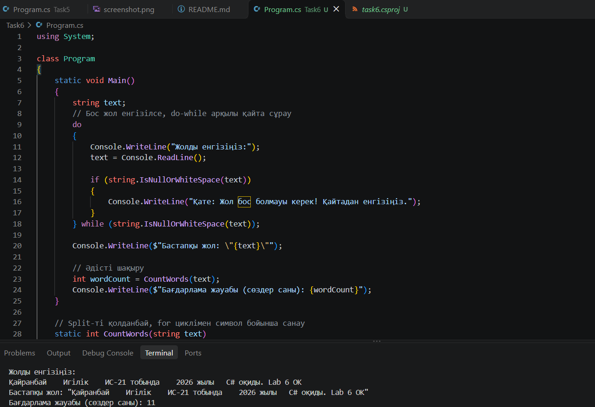

# 6-тапсырма: Символдар тіркесі (1-нұсқа)

| Тест | Кіріс | Қолмен есептеген жауап | Бағдарлама жауабы |
|---|---|---|---|
| Жеке тест | `   Қайранбай    Игілік    ИС-21 тобында    2026 жылы   С# оқиды. Lab 6 OK   ` | 11 | 11 |
| Өз тестім 1 | `  Сәлем   әлем!  ` | 2 | 2 |
| Өз тестім 2 | `Бағдарламалау   технологиясы` | 2 | 2 |

## Сұрақтарға жауап
1) text[i] жолдың көрсетілген индекстегі символын қайтарады, типі — char. C# тілінде string өзгермейтін болғандықтан, text[i] = 'a' деп тікелей өзгертуге болмайды.
2) 1-нұсқа: Жаңа сөздің басталғанын символ бос орын емес екенін және флаг (inWord) арқылы анықтадым. Жол бос орыннан басталса да, флаг арқылы бағдарлама қате санамайды.
3) result += ch; орындалғанда ескі жол өзгермейді, жадыда жаңа жол жасалып, екеуі біріктіріліп жазылады.

## Кездескен қате
Қате: Жолдың басында бос орындар тұрғанда бағдарлама оларды сөз ретінде қабылдап, санды қате санады.
Қалай түзеттім: `inWord` атты логикалық флаг қосып, тек сөз басталған кезде ғана санауышты арттыратын етіп өзгерттім.
Түзеткен коммит: a1b2c3d

## Git
`git log --oneline --graph --all` командасының нәтижесі:
(Git Bash арқылы шыққан графты осында қоясыз)

1. task5 тармағында жасаған коммиттеріңіз main-ге қалай түсті? `git switch main` арқылы негізгі тармаққа ауысып, `git merge task5` арқылы қосылды. Біріктіргеннен кейін task5 тармағы өшірілмей сақталады.
2. commit пен push айырмашылығы неде? Commit — жергілікті компьютердегі тарихқа сақтау, ал Push — GitHub қашықтағы серверіне жіберу. Push жасамасаңыз, мұғалім көре алмайды.
3. .gitignore файлына не жаздыңыз және bin/, obj/ неге репозиторийге қосылмайды? .gitignore ішіне құрастырылу кезіндегі уақытша файлдар жазылады. bin/ және obj/ буындары әр компиляцияда өзгеретін және репозиторийді ауырлататын бинарлы файлдар болғандықтан қосылмайды.

## ЖИ қолдану
Қолданған жоқпын.

